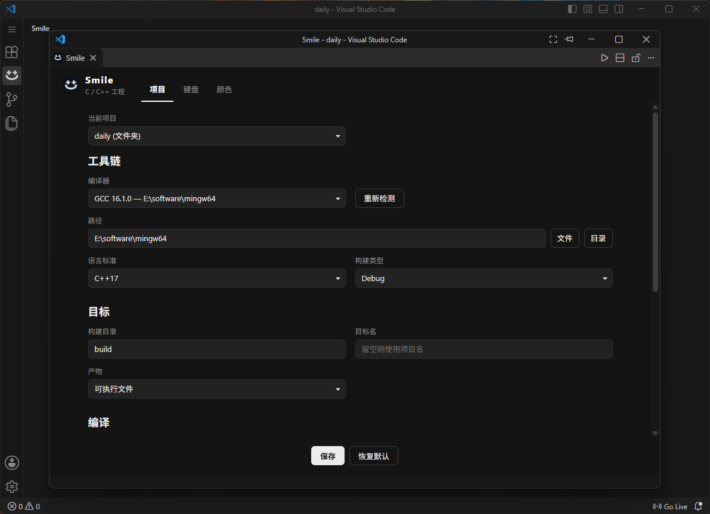
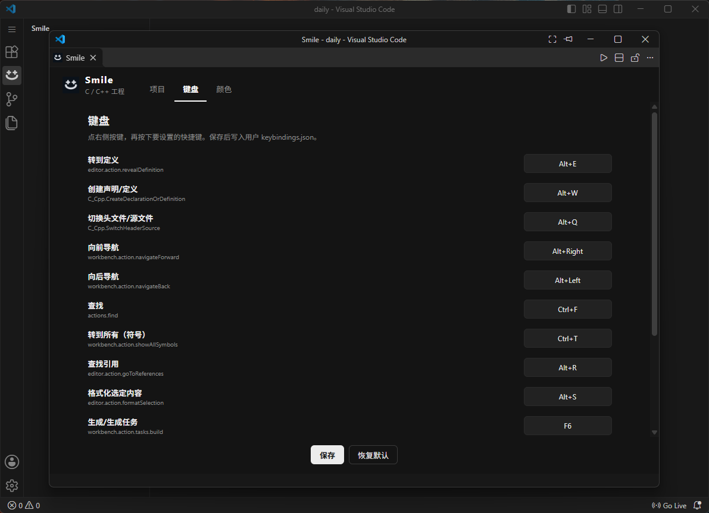
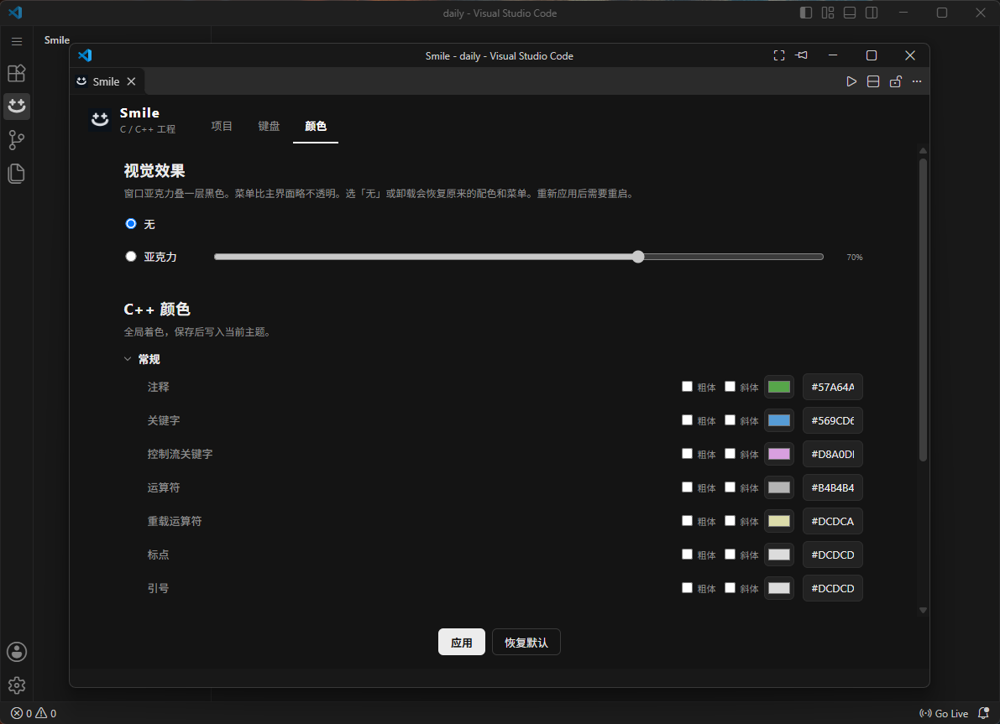

# Smile

## 界面

项目：选择编译器、语言标准和构建目标。



键盘：查看并修改快捷键。



颜色：设置视觉效果和 C++ 语法颜色。



面向 VS Code 的 C/C++ 扩展：用 GCC 或 Clang 配置工具链、构建和调试，并设置字体、语法颜色和快捷键。

配方：聪明的右脑 + AI + 懒惰的左脑

寄语：AI写的代码，开源只有一个目的，让有相同需求的小伙伴有个参考和基础

另：有bug自己改，我就是这么迪奥

## 构建

```bash
npm install
npm run compile
npm run package
```

- `compile`：编译 TypeScript 到 `out/`
- `package`：打出 `smile-cpp-1.1.0.vsix`，可在扩展面板选择 “Install from VSIX…” 安装

需要 Node.js，编辑器版本 `^1.85.0`。

## 许可证

MIT
